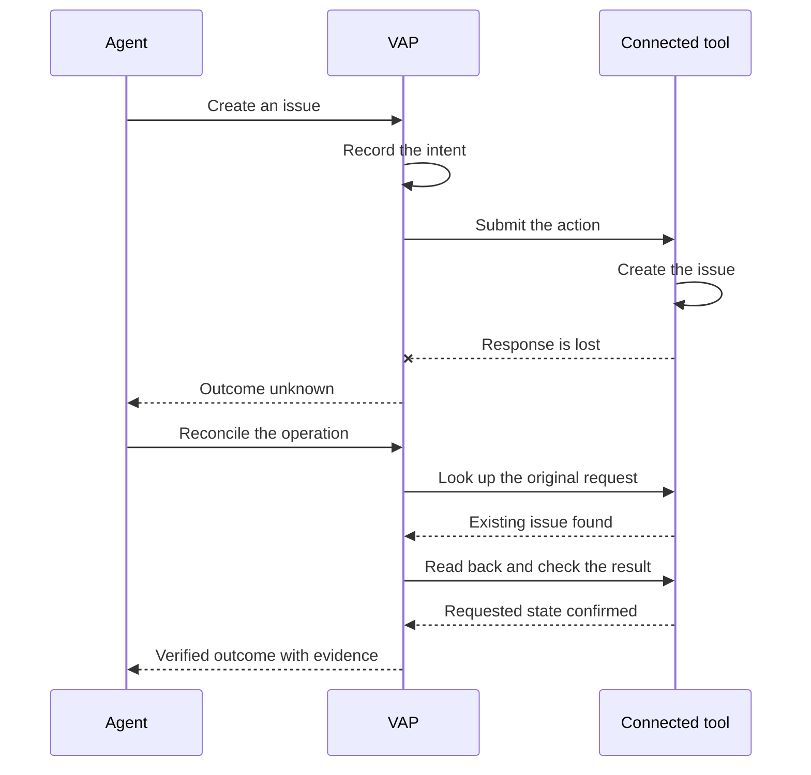
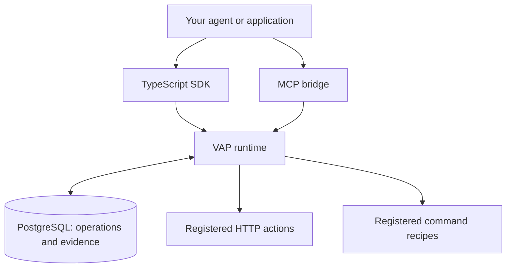

# VAP · Verified Action Protocol

**Give AI agents a clearer view of what they can do—and evidence of what actually happened.**

An open-source protocol and runtime for describing actions, recording execution, checking results
and recovering when outcomes are uncertain.

**Observe state. Prepare actions. Verify outcomes.**

*Experimental release 0.1.0-rc.1 · TypeScript SDK · HTTP and command adapters · MCP bridge · Apache-2.0*

[Try the demo](#try-vap) · [Connect your application](docs/connect.md) · [Read the protocol](docs/protocol/overview.md)

> **Experimental.** The protocol (0.1) and the APIs may change. The supported release is the core
> runtime, the HTTP and registered-command adapters, the SDK and the MCP bridge, run as
> containers. See [Status, security and limitations](#status-security-and-limitations).

## Why VAP exists

> **What would software look like if it were easier for AI agents to use?**
>
> VAP started with a question: "If we could make coding and operating software easier for an AI
> model, what would it ask for?"
>
> The answer was straightforward: expose the current state, the available actions and the
> outcome of each action in a consistent, verifiable way.
>
> VAP turns that idea into an execution contract for the tools you connect. An agent can inspect
> supported state, prepare a permitted action, track its execution and check whether the
> declared result actually happened.
>
> When the result cannot be established, VAP preserves that uncertainty instead of presenting it
> as success.

**Developers define the actions, checks and recovery behavior through adapters. VAP does not
automatically understand arbitrary software.**

## Questions VAP answers

| What the agent needs to know | What VAP provides |
|---|---|
| What is the current state? | Observations through registered adapters |
| What actions are available? | Structured action descriptions and input schemas |
| Am I allowed to do this? | Scoped grants and approval policies |
| What am I about to change? | An immutable plan with declared effects |
| Did the change actually happen? | Named checks, read-back evidence and a recorded outcome |
| What if the reply disappears? | Durable operation tracking and reconciliation before retry |

## When the reply is lost



**Demonstrated against the included synthetic issue tracker:** the response is lost, the existing
write is found and the result is verified without another submission. If the destination cannot
establish the outcome, the operation remains `unknown`. VAP does not promise exactly-once side
effects for every tool; it depends on what the connected tool lets it look up and read back.

## Try VAP

You need Docker with Compose v2 and an internet connection. No build, and no GitHub, model or
cloud account.

```bash
git clone https://github.com/arajgor1/verified-action-protocol.git
cd verified-action-protocol
docker compose -f examples/quickstart/compose.yaml run --rm demo
```

This starts PostgreSQL, the VAP runtime, a worker and a synthetic issue tracker from the release
image, then runs [`examples/quickstart/demo.mjs`](examples/quickstart/demo.mjs). You will see:

- **Verified action:** the saved state matches the requested result.
- **Lost response:** an unknown outcome is reconciled and verified, with exactly one write at the
  destination.
- **Partial batch:** applied effects are identified and compensated through a separate operation.

<details>
<summary>See the recorded output (lost response)</summary>

From the public check of the release (Cloud Build `a19a7891`, published image and npm packages):

```text
2a. Dropped response, before reconciliation (unknown, never shown as success)
operation op_hnLldiBA2WB3ubCJafCV  outcome=unknown
execution=unknown verification=not_requested recovery=none unresolved=true
  check owner_matches: missing (source - version null)
  effect issue_created: unknown
  retry guidance: reconcile_first - Effects cannot be established. Reconcile before any retry; if reconciliation cannot resolve it, an operator must.

2b. After reconciliation (found_applied)
operation op_hnLldiBA2WB3ubCJafCV  outcome=verified
execution=completed verification=passed recovery=none unresolved=false
  check owner_matches: pass (source http.issue_tracker:readback version 1)
  effect issue_created: applied issue://issue-tracker/issues/1001
  destination writes for this request: 1 (no duplicate)
  evidence:
    evd_OcN2SwRVcUzI2KMivJ66 check=owner_matches result=pass source=http.issue_tracker:readback version=1 freshness=fresh independence=same_process observed_at=2026-10-29T04:17:52.064Z
  events: operation.accepted -> dispatch.intent -> dispatch.result -> reconcile.started -> reconcile.result -> verification.started -> verification.result

summary: dropped response reconciled to verified with exactly one destination write
```

The full run, including the verified action and the partial batch, is recorded in
[quickstart-results.md](docs/release/quickstart-results.md).

</details>

The runtime keeps running after the demo. Remove everything, including the database volume:

```bash
docker compose -f examples/quickstart/compose.yaml down -v
```

The quickstart is for evaluation only: demo authentication (accepted only on the API container's
loopback interface), a fixed demo digest key and a synthetic destination. The image
(`ghcr.io/arajgor1/verified-action-protocol@sha256:d79c04bd44775e65750fe909f3194ca74ef9c796f10e8995aedb6a9d2c864849`)
is `linux/amd64` and was tested on an x86-64 Linux Docker host. Other platforms, such as Docker
Desktop on Apple silicon under emulation, are untested.

## Where it fits



Run the VAP runtime with PostgreSQL. Connect your application through the SDK, or expose VAP tools
to an MCP client through the bridge. Register the actions your tools support and the checks that
define success.

The SDK connects to the runtime; installing the SDK alone does not start VAP. More detail:
[architecture](docs/architecture.md).

## Connect your first tool

With the quickstart runtime from [Try VAP](#try-vap):

```bash
docker compose -f examples/quickstart/compose.yaml run --rm connect
```

This installs `@verified-action-protocol/sdk@0.1.0-rc.1` from npm in a throwaway Node.js 24
container and runs [`examples/connect/index.mjs`](examples/connect/index.mjs): one action from
request to `outcome=verified`. The core of it:

```js
import { VapClient, demoToken } from "@verified-action-protocol/sdk";

const agent = new VapClient({ baseUrl: "http://127.0.0.1:8080", token: demoToken("demo-agent") });
const task = await agent.openTask({ goal: "File an issue owned by erin", grant_id, scope, required_checks: [ownerIsErin] });
const plan = await agent.prepare({ task_id: task.id, action_id: "issues.create", arguments: { title: "Flaky checkout test", owner: "erin" } });
const { operation } = await agent.execute(plan.id, requestKey); // the same key again returns the same operation
const done = await agent.waitForOperation(operation.id);        // execution and verification are separate fields
console.log(done.outcome);                                       // "verified" only if every named check passed
```

In your own project:

```bash
npm install @verified-action-protocol/sdk@0.1.0-rc.1
```

Next steps:
- [Connect an application](docs/connect.md): the walkthrough, token providers for a real
  deployment, and three ways to put an existing tool behind VAP (an HTTP API through
  configuration only, a command-line program as a registered recipe, or an MCP client).
- [Custom HTTP action tutorial](docs/tutorial-custom-http-action.md): declare an action, its side
  effects, its conditional write and the lookup that lets a lost reply reconcile without a
  duplicate.
- [MCP bridge](docs/mcp.md): an ordinary stdio MCP server (`vap_task_open`, `vap_prepare`,
  `vap_execute`, `vap_verify`, `vap_reconcile`, ...) that holds no authority of its own.

<details>
<summary>Example: an HTTP action declared in configuration</summary>

Abridged; the tutorial adds the `lookup` block that lets a lost reply reconcile without
duplication.

```json
{
  "id": "issues.set_status",
  "title": "Set issue status",
  "connector": "issue_tracker",
  "method": "PATCH",
  "path": "/issues/{args.issue_id}",
  "input_schema": { "type": "object", "additionalProperties": false, "required": ["issue_id", "status"],
    "properties": { "issue_id": { "type": "string", "pattern": "^[0-9]{1,18}$" }, "status": { "enum": ["open", "in_progress", "closed"], "type": "string" } } },
  "body_fields": ["status"],
  "effect_scope": { "resource_template": "issue://issue-tracker/issues/{args.issue_id}", "description": "issue status" },
  "side_effects": [{ "id": "status_changed", "description": "issue status updated", "class": "remote_reversible", "bounded": true }],
  "conditional_write": { "resource": "issue://issue-tracker/issues/{args.issue_id}", "mode": "native", "header": "If-Match" },
  "request_key_header": "Idempotency-Key",
  "response": { "projection": ["/id", "/status", "/version"],
    "effects": [{ "side_effect_id": "status_changed", "resource_template": "issue://issue-tracker/issues/{result.id}", "version_pointer": "/version" }] }
}
```

</details>

## What has been demonstrated

- **Fault benchmark (scripted policies, synthetic destination).** Nine failure scenarios (lost
  replies, crashes mid-request, concurrent instances, changed payloads, rejections, unavailable
  lookups, delayed visibility), 180 runs in total. The agents are scripted policies, not models.
  VAP completed 35 of 35 completable runs with no duplicates and no false task success.
- **The honest baseline.** In the synthetic fault benchmark, VAP matched a carefully engineered
  client with its own durable intent log. VAP packages that discipline into shared infrastructure
  with consistent contracts, verification evidence and operation history. Naive retry did not
  match it (35 false task successes in 40 runs that claimed completion).
- **The cost.** On the normal path VAP took a median of 703 ms against 179–195 ms without it, for
  the plan, the durable journal writes and two read-back checks.
- **The release itself.** Both quickstart commands above were run unchanged in a fresh cloud
  environment against the published image and npm packages
  ([quickstart-results.md](docs/release/quickstart-results.md)).

Details: [benchmark results](docs/demo/ci-failure-results.md), the
[CI-failure demo](docs/demo/ci-failure.md) (one verified issue from a failed build, even after a
lost reply or a crash), the [release notes](docs/release-notes-0.1.0-rc.1.md),
[release manifest](docs/release/manifest.md) (commits, image digest, package checksums),
[candidate evidence](docs/release/candidate-evidence.md) and the
[acceptance matrix](docs/acceptance.md).

## Status, security and limitations

**Deploying.** The supported path is the image by digest as separate Docker containers
(migration job, API, worker) with PostgreSQL and an OIDC issuer:
[deployment-docker.md](docs/deployment-docker.md). The image's residual vulnerabilities are
accepted only under these deployment restrictions: non-root, no privileged mode, no added
capabilities or host devices, no root commands in the container, and limits on command recipes
([security decision record](docs/security/runtime-decision-record.md)).

**What VAP does not do.** No universal undo, no exactly-once remote side effects, no automatic
business semantics for arbitrary APIs, no prompt-injection immunity, no compliance certification,
no multi-tenant SaaS, no arbitrary code sandbox. Cancellation is never rollback. A verifier in the
same process is not organizational or cryptographic independence; evidence records say so
([limitations](docs/limitations.md)).

**Limits of this release:**
- **Managed Google Cloud deployment is experimental.** On the final image it passed once and
  failed once; in the failing attempt Cloud Scheduler received HTTP 401 from Cloud Run, and the
  cause is not established. The passing live SDK call used a test stand-in for the SDK's `gcloud`
  token source ([managed-staging-results.md](docs/release/managed-staging-results.md)).
- **Docker deployment** was validated in test mode against a synthetic destination with a local
  OIDC issuer; production mode end to end, real identity providers, TLS, backups and upgrades
  were not.
- **Not run:** the workflow against a real GitHub repository, and any comparison with
  model-driven agents.
- **Browser adapter and worker-browser image:** experimental, excluded from the release.
- **Residual CVEs:** 12 unfixed upstream findings in the image's Debian base, none with a fix
  available; 3 not affected, 9 accepted as exceptions under the restrictions above. Review date
  2027-01-28.
- **No public build provenance** for the npm packages or the image.
- The name "VAP" is provisional.

**Reporting vulnerabilities:** privately, as described in [SECURITY.md](SECURITY.md). Threat model:
[docs/security/threat-model.md](docs/security/threat-model.md).

## Documentation

- [Protocol overview](docs/protocol/overview.md), [outcomes](docs/protocol/outcomes.md) and
  [canonical JSON](docs/protocol/canonical-json.md)
- [Architecture](docs/architecture.md), [recovery](docs/recovery.md) and
  [adapter conformance](docs/adapter-conformance.md)
- [Connect an application](docs/connect.md), [SDK example](docs/sdk-example.md) and
  [MCP bridge](docs/mcp.md)
- [Docker deployment](docs/deployment-docker.md), [operations](docs/operations) and the
  experimental [Google Cloud deployment](docs/deployment-gcp.md)

<details>
<summary>How outcomes are recorded</summary>

Execution status and verification status are **separate fields**. `outcome` is derived from them
for display and never replaces them. A completed execution with failed verification is never
shown as success.

| What happened | What VAP records | Displayed outcome |
|---|---|---|
| a plan was prepared and execution accepted | `queued` | **requested** |
| submission may have reached the destination | `running` | **submitted** |
| the adapter finished, checks not yet passed | `completed` + `pending`/`inconclusive` | **completed_unverified** |
| every named check passed on fresh evidence | `completed` + `passed` | **verified** |
| a known subset of effects happened | `partial` | **partially_applied** |
| VAP cannot establish whether effects happened | `unknown` | **unknown**: reconcile before any retry |

</details>

<details>
<summary>What v0.1 contains</summary>

- **Protocol**: versioned JSON Schemas (draft 2020-12) for Task, Observation, Action, Plan,
  Operation, Evidence, Grant, Approval and Event; method contracts, error codes with retry
  dispositions, canonical JSON and keyed digests; executable examples validated in CI.
- **Runtime**: authenticated HTTP API, PostgreSQL journal with an outbox, fenced worker claims,
  immutable expiring plans, plan-bound single-use approvals, caller-scoped request keys,
  reconciliation, named-check verification, declared recovery and a sweeper.
- **Adapters**: a configurable JSON **HTTP** adapter (SSRF-guarded, conditional writes,
  destination deduplication with sealed lookups) and a **registered-command CLI** adapter
  (argument arrays, workspace containment, process-group cleanup, bounded output, never answers
  prompts). An experimental browser adapter exists but is disabled by default and not part of the
  supported release.
- **Integration**: a TypeScript client and adapter SDK, the `vap` CLI, and a stdio MCP bridge.
- **Operations**: a read-only viewer that shows uncertainty first, structured redacted logs,
  metrics and runbooks.

</details>

<details>
<summary>Repository map</summary>

| Path | Contents |
|---|---|
| `packages/protocol` | JSON Schemas, types, canonical JSON, errors, outcome derivation, examples |
| `packages/core` | policy, plans, lifecycle, reconciliation, verification, coordinator |
| `packages/store-postgres` | migrations, journal, outbox, fenced claims |
| `packages/sdk` | client, token providers, adapter SDK, static conformance, `vap` CLI |
| `packages/adapters` | HTTP, browser, registered-CLI adapters |
| `apps/api`, `apps/worker`, `apps/mcp` | gateway and viewer, dispatcher/sweeper, MCP bridge |
| `fixtures/` | deterministic issue tracker and registered CLI commands |
| `examples/` | quickstart, connect example, adapter configurations |
| `tests/` | unit, conformance, faults, security, browser, MCP, CI-failure demo |
| `benchmarks/` | deterministic baseline-vs-VAP harness and latency runs |
| `infra/gcp`, `scripts/` | Cloud Build pipelines, bootstrap/teardown, hygiene and evidence tools |
| `docs/` | protocol, architecture, operations, ADRs, acceptance matrix |

</details>

## Contributing and license

See [CONTRIBUTING.md](CONTRIBUTING.md). Commits are signed off (DCO). Tests run in the cloud; fork
pull requests wait for a maintainer to dispatch the exact SHA to the low-privilege test project.

Licensed under [Apache-2.0](LICENSE).
